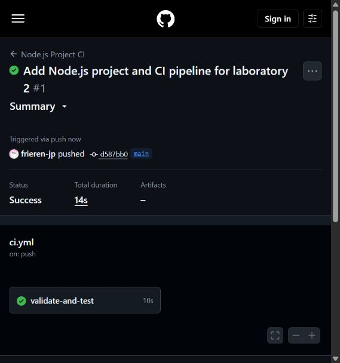
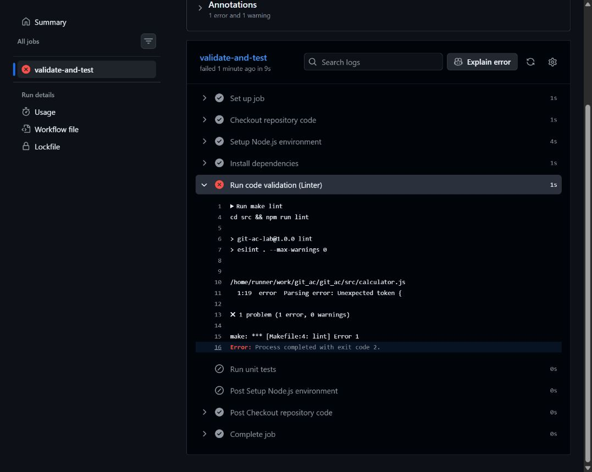
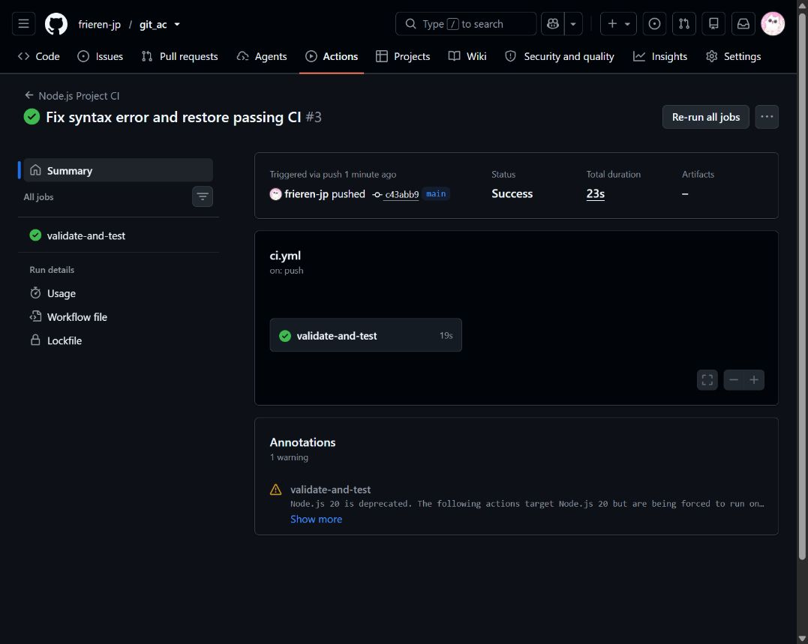

# Лабораторная работа №2

## Настройка CI в GitHub Actions для Node.js

Дата выполнения: 22 октября 2026 года.

Цель работы: настроить автоматическую установку зависимостей и проверку качества кода, проверить реакцию CI на синтаксическую ошибку и восстановить успешный статус.

Репозиторий: [frieren-jp/git_ac](https://github.com/frieren-jp/git_ac).

## Выполненная работа

Создан собственный Node.js-проект с функцией сложения чисел и проверкой входных аргументов. В каталоге src находятся package.json, package-lock.json, исходный код, конфигурация ESLint и три модульных теста. В корне создан Makefile с командами lint, test и start.

В .github/workflows/ci.yml настроен конвейер Node.js Project CI. Он запускается при push в main/master и при pull request в эти ветки. Добавлен ручной запуск. Задача validate-and-test выполняется на Ubuntu 22.04 с ограничением времени 15 минут. Последовательно выполняются checkout, установка Node.js 18.x, npm ci в каталоге src, make lint и make test. Версии Node.js и actions v4 соответствуют методичке. Исправлены отступы YAML и разделение слов в командах из исходного документа.

## Результаты запусков

| Этап | Коммит | Результат | GitHub Actions |
| --- | --- | --- | --- |
| Рабочий проект | d587bb0 | Success, 14 секунд | [Запуск №1](https://github.com/frieren-jp/git_ac/actions/runs/39743043477) |
| Намеренная ошибка | a875541 | Failure, 13 секунд | [Запуск №2](https://github.com/frieren-jp/git_ac/actions/runs/39743167190) |
| Исправление | c43abb9 | Success, 23 секунды | [Запуск №3](https://github.com/frieren-jp/git_ac/actions/runs/39743227634) |

### Первый успешный запуск



### Преднамеренный сбой линтера

В первой строке src/calculator.js удалена закрывающая круглая скобка:

```js
function add(a, b {
```

Шаг Run code validation (Linter) завершился ошибкой. Установка зависимостей перед ним прошла успешно. Модульные тесты после сбоя не запускались.

Фрагмент настоящего лога GitHub Actions:

```text
/home/runner/work/git_ac/git_ac/src/calculator.js
  1:19  error  Parsing error: Unexpected token {

✖ 1 problem (1 error, 0 warnings)

make: *** [Makefile:4: lint] Error 1
Error: Process completed with exit code 2.
```

ESLint вернул ошибку, а make завершился с кодом 2. [Полный лог шага](https://github.com/frieren-jp/git_ac/actions/runs/39743167190/job/119705115657#step:5:17).



### Восстановление работоспособности

Закрывающая скобка возвращена. После исправления линтер и три модульных теста прошли локально; повторный запуск GitHub Actions завершился успешно.



GitHub показывает предупреждение об устаревшем внутреннем Node.js runtime у actions v4 из методички. Оно не является причиной учебного сбоя: сбой вызван синтаксической ошибкой, а после её устранения задача получила статус Success.

## Ответы на контрольные вопросы

**1. Какую проблему решает Continuous Integration в команде?**

CI автоматически проверяет изменения в общем репозитории и помогает рано обнаруживать ошибки интеграции. Все участники получают одинаковые проверки в чистом окружении; результат не зависит от того, запускал ли разработчик проверки вручную.

**2. За что отвечают on и branches?**

Блок on задаёт события запуска workflow. Массив branches ограничивает ветки: для push это ветка, в которую отправлен коммит; для pull_request — целевая ветка запроса на слияние. В работе указаны main и master.

**3. Почему используется npm ci вместо npm install?**

npm ci устанавливает версии зависимостей из package-lock.json, предварительно удаляя существующий node_modules. Команда не обновляет lock-файл и завершается ошибкой при его несогласованности с package.json. Это обеспечивает воспроизводимую установку. npm install может изменить lock-файл.

**4. Как линтер защищает основную ветку?**

Линтер выявляет синтаксические ошибки и нарушения заданных правил. Его ненулевой код выхода делает CI неуспешным. Чтобы неуспешная проверка действительно запрещала слияние, в GitHub нужно установить обязательную проверку validate-and-test в правилах защиты ветки. Сам workflow сообщает об ошибке, но не запрещает прямой push. Линтер также не заменяет тестирование логики приложения.

## Вывод

Конвейер автоматически проверяет проект после отправки изменений. Эксперимент подтвердил обнаружение синтаксической ошибки и восстановление успешного статуса после исправления. Все три этапа подтверждены реальными запусками GitHub Actions и скриншотами.

## Документация

- [npm ci](https://docs.npmjs.com/cli/v11/commands/npm-ci/)
- [actions/setup-node](https://github.com/actions/setup-node)
- [actions/checkout](https://github.com/actions/checkout)
